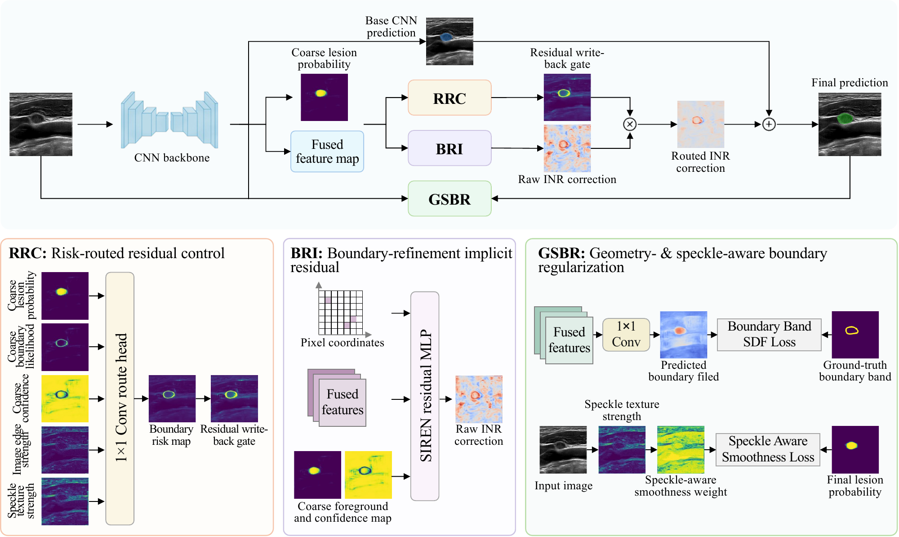
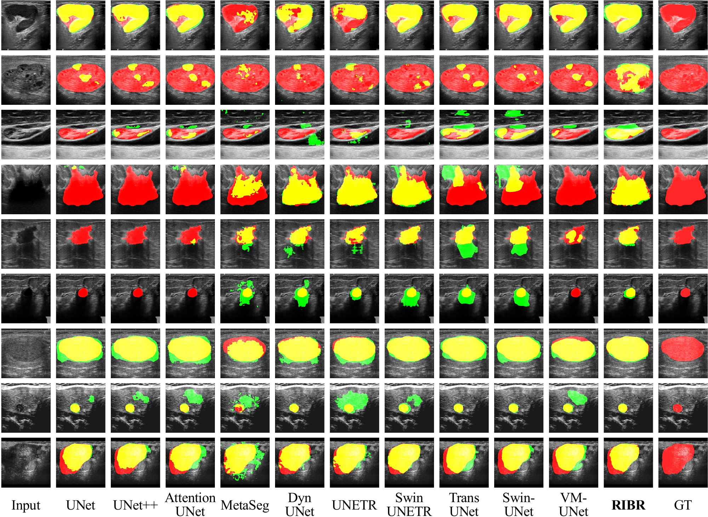

# RIBR

[Paper](https://arxiv.org/abs/2607.21787) · [Data](https://github.com/jinggqu/ribr/releases/tag/data-v1)

Code for *Risk-Routed Implicit Boundary Refinement for Robust Ultrasound Image Segmentation*.



## Setup and data

Requires Python 3.12+, `uv`, and Bash 3.2+. Run commands from the repository root.

```bash
uv sync --frozen
export DATA_ROOT=/path/to/ribr-data-v1
```

Extract `ribr-data-v1.tar.gz` from the data release to `DATA_ROOT`. The code uses the repository's `data_views/ribr-v1.csv` and `data_splits/ribr-v1`.

## Train and evaluate

```bash
uv run python -m src.methods.ribr.train_seg \
  --dataset BUSI --variant full --seed 1 --device cuda:0 \
  --data-root "$DATA_ROOT" --num-workers 0 --weak-augs
```

Outputs go to `runs/ribr-full-1/BUSI/256/`. For evaluation only, add `--test --checkpoint /path/to/best_model.pt`. External LN and breast cohorts use LN-INT and BUSI checkpoints, respectively. Other options are listed by `--help`.

## Ablations

Variants: `conv-only`, `gsbr-only`, `bri-only`, `bri-gsbr`, `bri-rrc`, `full`.

```bash
TRAIN_DATASETS=BUSI SEEDS="1 2 3" VARIANT=full DEVICE=cuda:0 \
bash scripts/segmentation/run_ribr_experiments.sh
```



## License

CC BY-NC 4.0.
